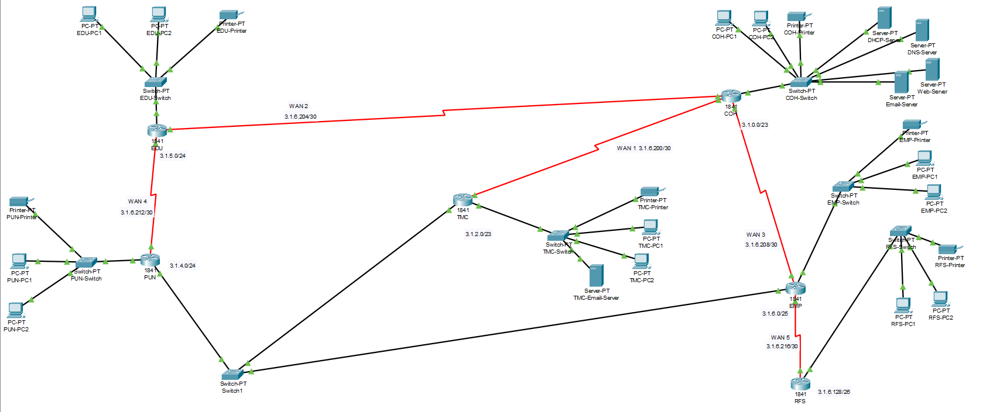

# Smart City Operations Network — Cisco Packet Tracer

A multi-site network designed and configured for **Metropolis Smart City Operations** using Cisco Packet Tracer. The project connects six city units using VLSM addressing, RIPv2 and different types of static routing. The network also includes DHCP, DNS, web and email services along with backup routing paths for basic fault tolerance.

> Course project for **CSE421 – Computer Networks**, Group 1903, BRAC University.
> Original requirements: [`docs/project-brief.pdf`](docs/project-brief.pdf)

## Key Concepts

* VLSM addressing
* RIPv2 and route redistribution
* Next-hop static routing
* Exit-interface static routing
* Recursive static routing
* Floating static routing
* DHCP and DHCP relay
* DNS, HTTP, SMTP and POP3
* Failover and loop prevention

## Tools

* Cisco Packet Tracer
* Cisco IOS CLI

---

## Project Overview

The goal of the project was to connect six different city units and allow them to communicate with each other while providing common network services.

The network was designed so that:

* Devices across all units can communicate with each other.
* DNS and web services are available through the network.
* Email communication works between the required units.
* DHCP is provided locally or through a DHCP relay where required.
* Static and dynamic routing are used according to the project requirements.
* Backup routes are available when selected links fail.
* No default routes are used.

## Network Topology



| Unit                          | Abbreviation | Devices | Role                                    |
| ----------------------------- | ------------ | ------- | --------------------------------------- |
| City Operations Hub           | COH          | 500     | Central backbone, DNS, web and DHCP     |
| Traffic Management Center     | TMC          | 300     | Traffic signals and sensors             |
| Public Utilities Node         | PUN          | 220     | Water, power and waste monitoring       |
| Emergency Dispatch Unit       | EDU          | 180     | Fire, police and ambulance coordination |
| Environmental Monitoring Post | EMP          | 90      | Air quality, weather and flood sensors  |
| Remote Field Station          | RFS          | 50      | Remote station connected through EMP    |

Each unit contains a router, switch, PCs and a printer.

The base `X.Y.0.0/16` network was divided using VLSM according to the required number of hosts for each unit. Point-to-point links were then assigned from the remaining address space.

The complete addressing table, VLSM calculations, router configurations and server setup are included in [`project-report.pdf`](project-report.pdf).

## Network Services

### DNS and Web

The COH network hosts the DNS and web server.

The website is available through:

`www.metropolis.city`

and displays:

**Smart City Operations - Online.**

### Email

Email servers were configured for COH and TMC using:

* SMTP
* POP3

This allows email communication between the two units.

### DHCP

DHCP was configured using both local DHCP servers and DHCP relay.

* COH uses a dedicated DHCP server.
* TMC, PUN, EDU and EMP have their own DHCP pools.
* COH provides DHCP to remote networks through `ip helper-address`.
* RFS uses static addressing.
* Servers, routers and printers use static IP addresses.

## Routing

The project uses both dynamic and static routing.

| Routing Method        | Location           | Purpose                                  |
| --------------------- | ------------------ | ---------------------------------------- |
| Next-hop static       | COH                | Reach the EDU network                    |
| Exit-interface static | RFS                | Reach other networks through EMP         |
| Recursive static      | EMP                | Reach COH through TMC                    |
| Floating static       | TMC                | Backup path to COH through PUN           |
| RIPv2                 | COH, TMC, PUN, EDU | Dynamic routing between the main routers |

COH also redistributes its static routes into RIPv2 so that the required networks can be reached through the dynamic routing domain.

## Testing

The following tests were performed or are intended to be verified before final submission:

* [ ] All-to-all connectivity between PCs, printers and servers
* [ ] `www.metropolis.city` opens correctly
* [ ] Email can be sent and received between COH and TMC
* [ ] DHCP clients receive valid addresses
* [ ] RFS remains static-only and reachable through EMP
* [ ] Floating static route activates when the TMC–COH link is disabled
* [ ] EMP remains reachable through TMC when the COH–EMP link is disabled
* [ ] `show ip route` confirms that no default routes are configured

Screenshots of the completed tests can be added to the `screenshots/` folder.

## Repository Structure

```text
smart-city-network-packet-tracer/
│
├── README.md
├── 421Project_group_1903.pkt
├── network-topology.png
├── project-report.pdf
├── docs/
│   └── project-brief.pdf
└── screenshots/
    ├── topology.png
    ├── router-config.png
    └── connectivity-test.png
```

## How to Open

1. Install Cisco Packet Tracer.
2. Open `421Project_group_1903.pkt`.
3. Allow some time for RIPv2 to converge.
4. Test connectivity and the configured network services.

## Team

| Member         | Contribution                                                  |
| -------------- | ------------------------------------------------------------- |
| Nahian Raidah  | Addressing, DHCP configuration and server configuration       |
| Afia Labiba    | DHCP configuration, routing design and server configuration   |
| Yasha Ehtesham | Topology design, wiring and interface configuration           |
| Tanmoy Saha    | VLSM tree diagram, static IP configuration and routing design |


## Future Improvements

* Add more smart city units and network segments
* Expand network services and server capabilities
* Implement additional routing and redundancy mechanisms
* Improve network monitoring and fault detection
* Add more detailed traffic and performance analysis

## Author

**Nahian Raidah**
Computer Science & Engineering

## Project Type

Academic / Educational Project

> **Disclaimer:** This project is an educational simulation of a multi-site smart city network using Cisco Packet Tracer. The network configuration and services are designed for academic demonstration and may not represent a production-ready deployment.